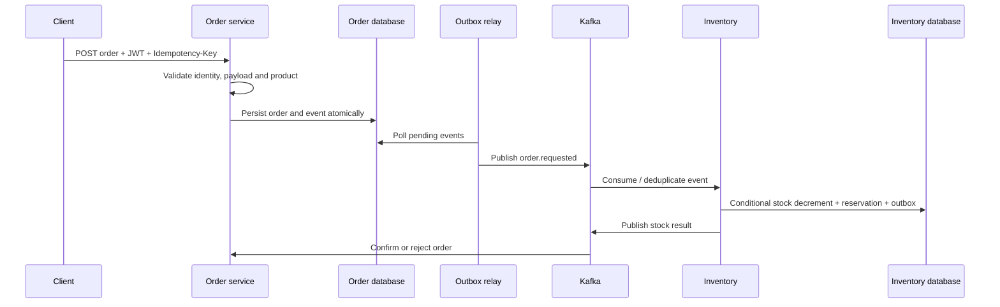

# OmniOrder — Asynchronous Order and Inventory Platform

OmniOrder is a Java/Spring Boot backend portfolio focused on idempotent order creation, inventory reservation under contention, and asynchronous state changes across service boundaries.

## At a glance

- **Problem:** prevent overselling and duplicate order effects while order and inventory services use independent transactions.
- **Flow:** authenticated order request → durable order plus outbox → Kafka → atomic inventory reservation plus result event → order state transition; reconciliation detects work that remains pending.
- **Current evidence:** PostgreSQL and Kafka Testcontainers are used for integration coverage. Identity tests passed 7/7, inventory integration tests passed 3/3, and the focused 1,000-request flash-sale test passed 1/1 in 180.5 seconds after the latest fixes. The complete Maven `verify` passed after the fixes: 19 current tests across identity, inventory and order modules; no test failures/errors/skips. The legacy `tests/integration/target` report is stale and excluded from this current-run count.
- **Database boundary:** PostgreSQL is the only implemented runtime. `SPEC.md` calls for Oracle schemas and Oracle XE verification; that requirement is not implemented, so Oracle support must not be claimed.
- **Readiness:** production readiness and production deployment are not established.

## Architecture and request flow

The outbox closes the local database-commit/message-publish gap, while Kafka keeps inventory processing asynchronous. A request can remain `PENDING` during broker or consumer outages; durable retries, deduplication, and reconciliation are needed to recover. Inventory owns the atomic stock reservation. The gRPC product lookup is informational and does not reserve stock.

## Design decisions and trade-offs

| Decision | Why it is used | Trade-off / failure case |
|---|---|---|
| Transactional outbox | Stores business state and event intent in one database transaction | Relay retries can duplicate publication; consumers must deduplicate and operators need backlog visibility |
| Kafka between order and inventory | Decouples service availability and permits asynchronous processing | Broker/consumer outage increases pending orders; replay and reconciliation must be correct |
| Durable idempotency and event deduplication | Makes client retries and broker redelivery safe | Uniqueness scope, payload mismatch behavior, and retention need explicit API guarantees |
| Atomic conditional stock update | Prevents stock from dropping below zero under concurrent reservations | Hot products contend on a row; scale and latency need measured workloads |
| PostgreSQL implementation | Current Compose, migrations, and Testcontainers use PostgreSQL | `SPEC.md` and ADR-0001 specify Oracle schemas; Oracle driver, migrations, profile, and XE verification are absent |

## Repository map

- `services/identity-service/` — registration, authentication, RS256 tokens, Argon2id password hashing.
- `services/order-service/` — order API, idempotency, outbox, consumers, state machine and reconciliation.
- `services/inventory-service/` — inventory reservation, gRPC product lookup and Kafka processing.
- `services/gateway/`, `services/notification-worker/`, `services/audit-worker/` — supporting modules.
- `infrastructure/` — Docker and Kubernetes configuration.
- `.gitlab-ci.yml` — compile/test, SonarQube, dependency/secret/Trivy scans, image packaging/scan and gated staging pipeline.
- `docs/audit/qa-audit.md` — acceptance results, evidence, limitations, and follow-up.

## Verification and security

The CI definition makes SonarQube, dependency, secret, Trivy filesystem and image scans blocking. Sonar requires protected `SONAR_HOST_URL` and `SONAR_TOKEN` variables and waits for the quality gate. Pipeline source does not prove a successful hosted run; this checkout has no attached GitLab job or scanner reports.

The passing flash-sale integration test submits 1,000 requests against five units and checks terminal order states, no negative stock, and reservation outcomes. The latest report is 1 test, 0 failures/errors, 180.5 seconds. The test replaces JWT decoding and the inventory gRPC price lookup with mocks. Treat it as a bounded integration scenario, not a throughput benchmark or proof of the complete deployed identity/gRPC path. Surefire also logged scheduler/database disconnect noise during Testcontainers teardown; the test report itself is green, but lifecycle isolation needs follow-up.

PostgreSQL/Testcontainers is real database evidence, but it does not satisfy Oracle-specific compatibility. Kafka integration tests use Testcontainers. Staging has not been run because no Kubernetes target, namespace, registry authorization, or new environment credentials were configured.

## Production readiness

| Area | Evidence | Assessment |
|---|---|---|
| Order/inventory correctness | Outbox, idempotency, atomic reservation and reconciliation code; selected container tests | Meaningful implementation; complete outage/replay and recovery evidence remains incomplete |
| Concurrency | `FlashSaleE2ETest` includes a 1,000-request / five-stock scenario | Bounded correctness scenario; JWT and price gRPC are mocked and no performance result is claimed |
| Database | PostgreSQL migrations and Testcontainers | Oracle target from `SPEC.md` is not implemented |
| Security | RS256/JWT, Argon2id, secret references in Kubernetes template, fail-closed CI scans | Hosted scan results and production secret provisioning are not evidenced; local Compose requires external DB credentials and key resource paths |
| Delivery | GitLab stages for verification, scans, package, image scan and staging | No hosted pipeline or staging smoke result is attached |

**Conclusion:** production readiness is not established. **Production-deployed:** no deployment was attempted or evidenced. To claim readiness, implement Oracle profiles/migrations and run Oracle XE verification, complete broker outage/replay/reconciliation tests, resolve scanner findings, and validate staging using isolated infrastructure and rotated credentials.

## Ownership and interview discussion

This README describes repository behavior and does not assign individual authorship without contribution evidence. Useful interview topics include outbox delivery semantics, idempotent consumption, atomic stock reservation under contention, recovery of stale `PENDING` orders, Oracle-versus-PostgreSQL compatibility, and the limits of a mocked edge in the flash-sale test.
